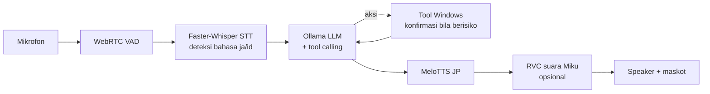

<div align="center">


# MikuVision

**Asisten desktop Windows berwujud Hatsune Miku, 100% lokal.**<br>
Mendengar suara Anda, berpikir dengan LLM lokal, menjalankan aksi di komputer, lalu menjawab dengan suara Miku.

[](#kebutuhan)
[](#kebutuhan)
[](#pilihan-model)
[](#instalasi-cepat)
[-39C5BB)](#lisensi--kredit)

[Instalasi cepat](#instalasi-cepat) ·
[Fitur](#fitur) ·
[Menjalankan](#menjalankan) ·
[Suara Miku (RVC)](#suara-miku-rvc) ·
[Troubleshooting](#troubleshooting) ·
[Changelog](CHANGELOG.md)


</div>

## Fitur

| | |
|---|---|
| **Suara dua arah** | Faster-Whisper `large-v3-turbo` mendengar bahasa Jepang dan Indonesia (bahasa dideteksi otomatis, halusinasi Whisper dibuang), MeloTTS Jepang + RVC untuk timbre khas Miku |
| **Aksi di komputer** | Volume, buka aplikasi/folder/situs, YouTube, dokumen Word/PowerPoint lengkap dengan isinya, WhatsApp/Telegram, keyboard shortcut |
| **LLM lokal** | `qwen3:4b-instruct` lewat Ollama dengan tool calling: 50/50 tool call tepat, median 0,9 s di RTX 4050 |
| **Aman** | Aksi berisiko (kirim pesan, menutup aplikasi) selalu minta konfirmasi; aplikasi ditutup lewat `WM_CLOSE`, bukan kill paksa |
| **Ingatan** | Memori jangka panjang (`"ingat ya, ..."`), lanjutkan sesi lama, penghitung token dari Ollama |
| **Routine** | Satu perintah untuk banyak aksi (`"jalankan mode belajar"`), plus slash command tanpa LLM |
| **Maskot** | Sprite Miku beranimasi sesuai emosi, di GUI maupun sebagai maskot desktop |
| **Privat** | Semua berjalan di komputer Anda. Riwayat, memori, dan log tersimpan di `data/` dan tidak pernah ikut ke git |

### Cara kerja



## Instalasi cepat

> [!TIP]
> Satu klik: installer memasang Python, PyTorch, dependency, Ollama, dan model, lalu menguji hasilnya. Tidak perlu Anaconda.

1. **Ambil kode** ke folder di drive yang lega, misalnya `D:\MikuVision`:
   ```bash
   git clone https://github.com/MocArjunnaja/MikuVision.git D:\MikuVision
   ```
   Atau unduh ZIP dari [Releases](https://github.com/MocArjunnaja/MikuVision/releases) lalu ekstrak.
2. **Double-click `install.bat`** dan tunggu sampai muncul `Instalasi selesai.` (±15 menit pertama kali, tergantung internet).
3. **Buka shortcut MikuVision** di desktop.

<details>
<summary><b>Apa saja yang dilakukan installer?</b></summary>

| Langkah | Keterangan |
|---|---|
| Git | Dipasang lewat `winget` bila belum ada (ditanya dulu). Dibutuhkan untuk mengunduh MeloTTS |
| [uv](https://docs.astral.sh/uv/) 0.11.2 | Versi dipatok, checksum SHA-256 dicek, disimpan di `.tools\uv` |
| Python 3.10 | Python terisolasi di `.tools\python`, env di `.venv`. Tidak mengubah PATH atau registry |
| PyTorch 2.11 | GPU NVIDIA terdeteksi lewat `nvidia-smi` → build CUDA 12.8 (driver lama: 12.6). Tanpa GPU → build CPU, dengan peringatan |
| Dependency | `requirements.txt` + kamus `unidic` untuk MeloTTS, lalu cek semua modul bisa di-import |
| RVC | `rvc-python` ikut dipasang otomatis bila file model RVC sudah ada di `models\` |
| Ollama | Dipasang lewat `winget` bila belum ada (ditanya dulu), lalu `ollama pull` model dari `OLLAMA_MODEL` di `config.py` |
| Shortcut | **MikuVision** di desktop, membuka GUI tanpa jendela konsol |
| Verifikasi | `miku.py --test` harus lulus |

Installer aman dijalankan ulang: langkah yang sudah beres dilewati (±1 menit). Setiap jalan dicatat di `logs\install-<waktu>.log`; bila gagal, pesan `[ERROR]` terakhir menjelaskan penyebab dan langkah perbaikannya.

</details>

<details>
<summary><b>Opsi installer</b></summary>

Opsi bisa diteruskan lewat `install.bat` atau `install.ps1`, misalnya `install.bat -Yes -Cpu`.

| Opsi | Fungsi |
|---|---|
| `-Yes` | Jawab "ya" otomatis (instal Git/Ollama tanpa bertanya) |
| `-Cpu` | Paksa PyTorch CPU walau ada GPU NVIDIA |
| `-WithRvc` | Pasang `rvc-python` walau model RVC belum diletakkan |
| `-SkipOllama`, `-SkipShortcut`, `-SkipTest` | Lewati langkah tersebut |
| `-PythonVersion 3.x` | Ganti versi Python (default 3.10; RVC tidak jalan di 3.11) |

</details>

<details>
<summary><b>Ruang disk dan lokasi file</b></summary>

| Isi | Ukuran | Lokasi |
|---|---|---|
| Python, PyTorch CUDA, dependency | ±6 GB | Folder aplikasi (`.tools\`, `.venv\`) |
| Whisper + MeloTTS | ±2 GB | Cache Hugging Face, default `C:\Users\<user>\.cache\huggingface` |
| Model LLM | ±2,5 GB | Ollama, default `C:\Users\<user>\.ollama\models` |

Bila drive C sempit, buat variabel environment user `HF_HOME` (misalnya `D:\hf_home`) dan `OLLAMA_MODELS` (misalnya `D:\ollama_models`) **sebelum** menjalankan installer, lalu restart Ollama.

**Menghapus:** tutup MikuVision, hapus folder aplikasi dan shortcut desktop. Ollama di-uninstall terpisah lewat Settings → Apps.

</details>

<details>
<summary><b>Instalasi manual (conda)</b></summary>

1. Clone repo dan masuk ke foldernya:
   ```bash
   git clone https://github.com/MocArjunnaja/MikuVision.git
   ```
   ```bash
   cd MikuVision
   ```
2. Buat environment Python 3.10:
   ```bash
   conda create -n miku python=3.10 -y
   ```
   ```bash
   conda activate miku
   ```
3. Khusus GPU NVIDIA, pasang PyTorch CUDA dulu (perintah lain di [pytorch.org](https://pytorch.org/get-started/locally/)):
   ```bash
   pip install torch torchaudio --index-url https://download.pytorch.org/whl/cu128
   ```
4. Pasang dependency dan kamus Jepang untuk MeloTTS:
   ```bash
   pip install -r requirements.txt
   ```
   ```bash
   python -m unidic download
   ```
5. Siapkan LLM:
   ```bash
   ollama pull qwen3:4b-instruct
   ```
6. Cek instalasi; harus berakhir dengan `[Test mode - Initialization successful!]`:
   ```bash
   python miku.py --test
   ```

</details>

### Linux (eksperimental)

Teruji di Linux Mint 22.3 (Cinnamon, X11) dengan RTX 4050. Suara dua arah, LLM, RVC, GUI, dokumen, dan aksi desktop (volume, buka/tutup aplikasi, buka folder, media) sudah jalan, semuanya tanpa sudo. Perbedaan dari Windows: WhatsApp hanya menyiapkan draf di WhatsApp Web (tekan Enter sendiri), Telegram butuh Telegram Desktop, dan maskot belum transparan. Rencana berikutnya ada di [docs/PLAN_LINUX.md](docs/PLAN_LINUX.md).

1. Pastikan driver NVIDIA aktif: `nvidia-smi` harus menampilkan GPU. Setelah memasang driver baru, reboot dulu.
2. Ambil kode, lalu jalankan installer dari folder repo:
   ```bash
   ./install.sh
   ```
   Installer menanyakan dulu sebelum memakai `sudo`: paket sistem lewat `apt`, `dnf`, `pacman`, atau `zypper` (git, PortAudio, xdotool, wmctrl, playerctl, xclip) dan Ollama dari skrip resminya. Opsi sama seperti versi Windows: `--yes`, `--cpu`, `--with-rvc`, `--skip-ollama`, `--skip-shortcut`, `--skip-test`, `--python-version 3.x`.
3. Buka **MikuVision** dari menu aplikasi atau Desktop, atau jalankan `./run.sh`.

<details>
<summary><b>Catatan Linux</b></summary>

- **Lokasi env:** bila folder repo ada di partisi Windows (NTFS/FAT, misalnya dual-boot), uv, Python 3.10, dan venv disimpan di `~/.local/share/mikuvision/` karena venv di NTFS lambat. Di partisi Linux biasa: `.tools/` dan `.venv/` di folder repo. Lokasi lain: `MIKU_VENV=/path/venv`.
- **Sesi X11** dibutuhkan untuk aksi keyboard/mouse; di Wayland installer memberi peringatan.
- **Distro lain:** installer mengenali keluarga Debian/Ubuntu (apt), Fedora/RHEL (dnf), Arch/Manjaro (pacman), dan openSUSE (zypper), lalu memakai nama paket distro itu. Distro selain itu: pasang paket di atas sendiri. Yang baru diuji langsung hanya Linux Mint; rinciannya di [docs/PLAN_LINUX.md](docs/PLAN_LINUX.md) bagian L5.
- **Ollama** jalan sebagai service systemd; modelnya di `/usr/share/ollama/.ollama/models`.
- **Cache Hugging Face** (Whisper, MeloTTS): `~/.cache/huggingface`, atau atur `HF_HOME`.
- **Ruang disk:** ±11 GB env + cache uv, ±2 GB cache Hugging Face, ±2,5 GB model LLM.
- **Menghapus:** `rm -rf ~/.local/share/mikuvision ~/.local/share/applications/mikuvision.desktop ~/Desktop/MikuVision.desktop`. Ollama dihapus terpisah.

</details>

### Kebutuhan

| | Minimum | Teruji |
|---|---|---|
| OS | Windows 10/11 64-bit, atau Linux x86_64 dengan X11 (eksperimental) | Windows 11, Linux Mint 22.3 |
| GPU | Opsional (CPU bisa, tapi lambat) | NVIDIA RTX 4050 Laptop 6 GB |
| Disk | ±12 GB | |
| Lainnya | Mikrofon, internet saat instalasi | |

## Menjalankan

| Mode | Perintah | Keterangan |
|---|---|---|
| GUI | Shortcut **MikuVision**, `run.bat`, atau `python gui.py` | Jendela chat + tombol **Hold to Speak** |
| Suara + maskot | `python miku.py` | Seret maskot Miku di layar untuk mulai bicara |
| Teks (terminal) | `python miku.py --text` | Paling mudah untuk mencoba pertama kali |
| Lanjutkan sesi | `python miku.py --text --resume` | Sesi terakhir, atau `--resume <SESSION_ID>`; di GUI: tombol **↺ Sesi lalu** |

Dengan installer, ganti `python` dengan `.venv\Scripts\python.exe`. Di Linux: `~/.local/share/mikuvision/venv/bin/python` (repo di NTFS) atau `.venv/bin/python`, dan `run.sh` menggantikan `run.bat`.

**Contoh perintah:** "buka notepad", "kecilkan volume ke 30", "carikan lagu Yorushika di YouTube", "buka folder Downloads", "buatkan dokumen Word tentang Hukum Newton beserta rumusnya", "ingat ya, aku kuliah di ITS".

Miku membalas dalam bahasa Jepang, tapi isi dokumen yang dibuatnya mengikuti bahasa permintaan Anda.

> [!IMPORTANT]
> Aksi berisiko (kirim WhatsApp/Telegram, menutup aplikasi) **selalu meminta konfirmasi**: `y/n` di mode teks, jawaban "ya/はい" di mode suara, atau dialog Yes/No di GUI.

### Routine & slash command

**Routine** menjalankan beberapa aksi dengan satu perintah. Contoh bawaan ada di `routines.example.yaml` ("mode belajar", "mode istirahat"). Untuk membuat routine sendiri, salin file itu ke `data/routines.yaml` lalu ubah isinya. Jalankan dengan ucapan ("jalankan mode belajar", "勉強モードにして") atau `/routine mode belajar`. Langkah berisiko tetap meminta konfirmasi.

**Slash command** (mode teks dan GUI, tanpa LLM):

| Perintah | Fungsi |
|---|---|
| `/help` | Daftar perintah |
| `/memory`, `/forget <key>` | Lihat / hapus memori jangka panjang |
| `/routines`, `/routine <nama>` | Daftar / jalankan routine |
| `/skills` | Kelompok kemampuan Miku |
| `/sessions`, `/resume [id]` | Sesi tersimpan / lanjutkan sesi |
| `/usage` | Pemakaian token sesi ini |
| `/clear` | Hapus riwayat sesi ini |

**Skill on-demand:** 25 tool dikelompokkan menjadi 9 skill (`core/skills.py`). Hanya skill yang cocok dengan permintaan yang dikirim ke LLM, sehingga prompt turun dari ±3.400 ke ±1.550 token tanpa menurunkan akurasi. Matikan dengan `SKILL_ROUTING = False` di `config.py`.

### Memori & pemakaian token

- **Konteks:** setiap balasan menampilkan pemakaian konteks dari Ollama (`prompt_eval_count`), misalnya `konteks 3.2k / 8.2k token`. Di GUI angka ini ada di bawah status.
- **Memori jangka panjang:** fakta yang disimpan dengan tool `remember` disisipkan ke system prompt (maksimal `MEMORY_PROMPT_MAX_FACTS`, default 15), sehingga Miku tetap ingat setelah aplikasi ditutup.
- **Agent loop:** tool call dan hasilnya disimpan dalam format resmi Ollama (`tool_calls` + pesan `role: tool`), sehingga Miku tahu apa yang sudah dilakukannya di giliran sebelumnya.

## Pilihan model

Benchmark di RTX 4050 6 GB: 10 perintah (JP/ID), 3–5 kali ulang, tool tidak dieksekusi.

| `OLLAMA_MODEL` | Tool call tepat | Latensi median | Catatan |
|---|---|---|---|
| `qwen3:4b-instruct` (default) | 50/50 | 0,9 s | Paling responsif untuk asisten suara; di tengah percakapan 8/8 |
| `qwen3:4b` | 30/30 | 11,5 s | Varian Thinking-2507: paling akurat, tapi berpikir dulu sebelum menjawab |
| `granite4.2:3b` | 25/30 | 4,6 s | IBM Granite; bahasa Indonesia tidak didukung resmi |

Model kecil kadang hanya *berjanji* melakukan aksi tanpa memanggil tool; MikuVision otomatis meminta ulang (maksimal 2 kali). Angka `qwen3:4b-instruct` sudah termasuk mekanisme ini; dua model lain diukur sebelum mekanisme ini ada.

Biarkan `OLLAMA_THINK = None` di `config.py`. Mengirim `think=False` ke `qwen3:4b` justru membuat penalarannya ikut terucap.

Model LLM dimuat lebih dulu daripada Whisper dan RVC, lalu ditahan di VRAM selama MikuVision jalan (`OLLAMA_KEEP_ALIVE = -1`) dan dilepas saat ditutup. Di GPU 6 GB, model yang dimuat belakangan tidak muat penuh dan sebagian berjalan di CPU (balasan pertama 49 s, bukan 1,3 s).

## Suara Miku (RVC)

Tanpa RVC, Miku bicara memakai suara dasar MeloTTS Jepang. Untuk timbre khas Miku, siapkan model RVC v2 milik Anda sendiri (tidak disertakan di repo):

1. Simpan file bobot ke `models/miku_default_rvc/weights/miku_default_rvc.pth`.
2. Simpan file index ke `models/miku_default_rvc/logs/miku_default_rvc/added_IVF4457_Flat_nprobe_1_miku_default_rvc_v2.index` (atau ubah `index_path` di `config.py` sesuai nama file Anda).
3. Jalankan ulang `install.bat`. Installer mendeteksi model dan memasang `rvc-python`; GUI lalu menampilkan **RVC: ready**.

Catatan teknis:
- `rvc-python` bergantung pada `fairseq 0.12.2`, yang hanya tersedia sebagai source code dan dikompilasi saat instalasi. Bila gagal, pasang [Visual Studio Build Tools](https://visualstudio.microsoft.com/visual-cpp-build-tools/) dengan workload **Desktop development with C++**, lalu jalankan installer lagi. Aplikasi tetap jalan tanpa RVC.
- `fairseq` tidak jalan di Python 3.11, karena itu installer memakai Python 3.10.
- Konversi pertama mengunduh `hubert_base.pt` dan `rmvpe.pt` (sekali saja). Setelah itu ±1 detik per kalimat di RTX 4050.

> [!WARNING]
> Installer **tidak** mengunduh model RVC, dan repo ini tidak menunjuk ke model tertentu: hampir semua model RVC Miku yang beredar dilatih dari suara VOCALOID tanpa izin tertulis yang jelas (lihat [Lisensi & kredit](#lisensi--kredit)). File `.pth` juga file pickle yang bisa menjalankan kode saat dimuat. Hanya pakai model dari sumber yang Anda percayai, dan jangan unggah ulang model tersebut ke repo ini.

## Data & privasi

- Riwayat percakapan di `data/conversations/`; log per giliran (input, tool + hasil, token, latensi) di `data/logs/turns_YYYYMMDD.jsonl`.
- Output GUI yang dibuka lewat shortcut (tanpa konsol) dicatat di `data/logs/gui.log`.
- Memori jangka panjang di `data/long_term_memory.json`. Isi lewat ucapan seperti "ingat ya, aku kuliah di ITS" atau "誕生日を覚えておいて", hapus dengan "lupakan …" / "…を忘れて".
- Dokumen buatan Miku tersimpan di `Desktop/Miku_Documents/` milik user yang sedang login.
- Fitur WhatsApp memakai `data/contacts_db.json` berformat `{"nama": "62812xxxx"}` (buat sendiri).
- Rekaman mic tidak disimpan. Untuk debugging audio, set `DEBUG_DUMP_AUDIO = True` di `config.py`; rekaman lalu tersimpan di `data/debug_audio/`.
- Seluruh `data/` diabaikan git dan tidak pernah ikut di-commit.

## Pengembangan

```bash
pip install pytest
```
```bash
pytest
```

Test tidak membutuhkan mikrofon, GPU, maupun Ollama. Catatan perubahan, angka pengujian, dan keputusan teknis ada di [CHANGELOG.md](CHANGELOG.md).

Benchmark yang butuh GPU/Ollama ada di `experiments/` beserta hasilnya (`RESULTS.md`):

| Folder | Mengukur |
|---|---|
| `experiments/stt_eval/` | Akurasi STT Jepang/Indonesia, suara bersih dan mic laptop berderau |
| `experiments/word_tool/` | Permintaan dokumen Word → `create_word_document` dengan isi |
| `experiments/vision_phase0/` | Rencana agent visi: UI Automation, OCR, pemilihan elemen oleh model visi |

## Troubleshooting

| Gejala | Solusi |
|---|---|
| `install.bat` gagal | Baca pesan `[ERROR]` terakhir dan `logs\install-*.log`, perbaiki, lalu jalankan ulang |
| Shortcut MikuVision tidak membuka apa-apa | Lihat `data/logs/gui.log`, atau jalankan `run.bat` untuk melihat error di konsol |
| `Model 'qwen3:4b-instruct' tidak ditemukan` | Jalankan `ollama pull qwen3:4b-instruct`, pastikan aplikasi Ollama sedang berjalan |
| `Gagal connect ke Ollama` | Buka aplikasi Ollama (ikon di system tray) |
| Error MeloTTS / `unidic` | Jalankan `python -m unidic download` |
| `RVC unavailable` | Model RVC belum diletakkan, atau `rvc-python` gagal dipasang. Lihat [Suara Miku (RVC)](#suara-miku-rvc) |
| `webrtcvad` gagal di-install | Pastikan memakai paket `webrtcvad-wheels` dari `requirements.txt` |
| Whisper sangat lambat | Tanpa GPU, ganti `WHISPER_MODEL` di `config.py` ke `small` |
| Ucapan sering salah dengar | Set `DEBUG_DUMP_AUDIO = True`, ulangi ucapannya, lalu cek rekaman di `data/debug_audio/` dan baris `[VoiceInput] Bahasa: …` di log |
| Ucapan bahasa Inggris sering salah | Deteksi bawaan hanya `ja` dan `id`. Tambahkan `"en"` ke `WHISPER_LANGUAGES` di `config.py` |
| Linux: `install.sh` berhenti di `nvidia-smi gagal` | Driver NVIDIA terpasang tapi belum aktif. Reboot, atau pakai `--cpu` |
| Suara Miku kadang jadi suara MeloTTS biasa | Cari `CUDA out of memory` di `data/logs/gui.log`: VRAM penuh. Tutup aplikasi lain yang memakai GPU NVIDIA, atau kecilkan `chunk_sec` di `RVCConfig` (`config.py`) |
| Balasan LLM lambat | Jalankan `ollama ps`: kolom PROCESSOR harus `100% GPU`. Bila ada bagian CPU, aplikasi lain memakai VRAM saat model dimuat; tutup aplikasi itu lalu buka ulang MikuVision |
| Linux: emoji tampil sebagai kotak di GUI | Tk di Linux belum menampilkan emoji berwarna; hanya kosmetik |

## Lisensi & kredit

Hatsune Miku © Crypton Future Media, INC. www.piapro.net. Proyek non-komersial.

Catatan aset (bukan nasihat hukum; dicek 25 Oktober 2026):

| Aset | Status | Catatan |
|---|---|---|
| Karakter Hatsune Miku | [Piapro Character License](https://piapro.net/license) (PCL) atau CC BY-NC 3.0 untuk ilustrasi resmi Crypton | Hanya untuk penggunaan **non-komersial** (tanpa tujuan bisnis dan tanpa menerima bayaran). Penggunaan komersial butuh izin Crypton. Dilarang memakai karakter dalam konteks yang merusak nama baiknya (misalnya terlalu kasar atau seksual) |
| Sprite maskot `assets/avatar/miku_smart_sheet.png` (juga `docs/images/`) | **Asal belum tercatat** | Masuk sejak commit pertama tanpa keterangan pembuat. Sprite turunan karakter tetap tunduk pada PCL, dan bila dibuat orang lain, hak ciptanya milik pembuatnya. Pembuat dan izinnya perlu dicatat di sini. Frame 106-116 (sedih, kesal, malu, bingung, berpikir) adalah suntingan frame asli oleh `tools/make_emote_frames.py`, jadi asal-usulnya sama dengan sheet ini |
| Model suara RVC | Tidak disertakan; disediakan sendiri oleh pengguna | Suara Miku berasal dari voicebank VOCALOID (sampel suara Saki Fujita) yang diatur EULA software Crypton, bukan PCL. Tidak ditemukan pernyataan resmi Crypton yang mengizinkan pelatihan model konversi suara dari voicebank tersebut. Perlakukan model RVC Miku sebagai untuk pemakaian pribadi saja, ikuti lisensi dari pembuat modelnya, dan jangan distribusikan |
| `rvc-python` | MIT | Dipasang bila model RVC ada, tidak dibundel |
| MeloTTS | MIT | Diunduh saat instalasi |
| faster-whisper, model Whisper | MIT | Model diunduh saat pertama jalan |
| Qwen3 (`qwen3:4b-instruct`) | Apache 2.0 | Diunduh lewat Ollama |
| Ollama; uv | MIT; MIT/Apache 2.0 | Dipasang oleh installer bila belum ada |
