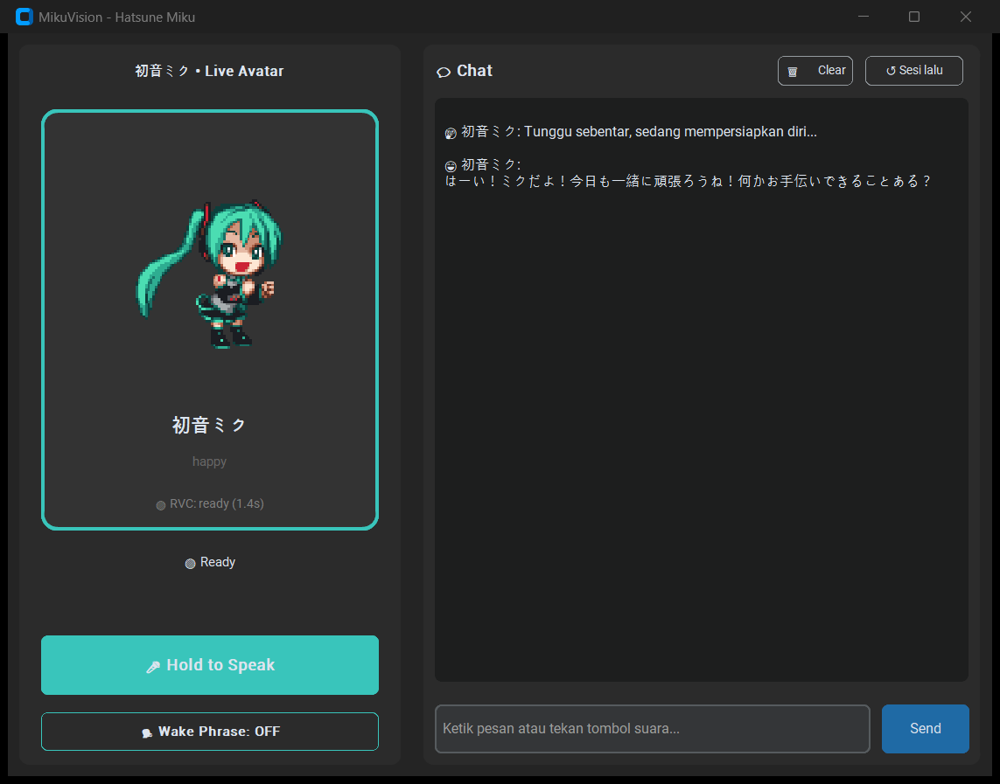

<div align="center">


# MikuVision

**Asisten desktop berwujud Hatsune Miku untuk Windows dan Linux, 100% lokal.**<br>
Mendengar suara Anda, berpikir dengan LLM lokal, menjalankan aksi di komputer, lalu menjawab dengan suara Miku.

[](#instalasi)
[-FCC624?logo=linux&logoColor=black)](#instalasi)
[](#instalasi)
[](#pilihan-model)
[-39C5BB)](#lisensi--kredit)

[Instalasi](#instalasi) ·
[Menjalankan](#menjalankan) ·
[Suara Miku (RVC)](#suara-miku-rvc) ·
[Troubleshooting](#troubleshooting) ·
[Changelog](CHANGELOG.md)



</div>

## Fitur

| | |
|---|---|
| **Suara dua arah** | Faster-Whisper mendengar bahasa Jepang dan Indonesia; MeloTTS Jepang + RVC untuk suara khas Miku |
| **Aksi di komputer** | Volume, buka/tutup aplikasi apa pun, folder, situs, YouTube, dokumen Word/PowerPoint lengkap dengan isinya, WhatsApp/Telegram, keyboard |
| **Membaca layar** | "error apa ini?", "bacakan tulisan di layar": Miku melihat jendela yang aktif lewat model visi lokal. Hanya melihat, tidak mengklik |
| **LLM lokal** | `qwen3:4b-instruct` lewat Ollama dengan tool calling, balasan ±1 detik di RTX 4050 |
| **Aman** | Aksi berisiko (kirim pesan, menutup aplikasi) selalu minta konfirmasi; aplikasi ditutup dengan sopan seperti tombol ✕ |
| **Ingatan, routine & skill** | Memori jangka panjang (`"ingat ya, ..."`), lanjutkan sesi lama, satu perintah untuk banyak aksi (`"jalankan mode belajar"`), dan skill yang disimpan dari percakapan (`"simpan ini sebagai skill"`) |
| **Maskot** | Sprite Miku beranimasi sesuai emosi, di GUI maupun sebagai maskot desktop; `Ctrl+Shift+M` untuk mulai bicara dari aplikasi mana pun |
| **Privat** | Semua berjalan di komputer Anda; riwayat dan memori di `data/`, tidak pernah ikut ke git |

## Instalasi

1. Ambil kode ke folder di drive yang lega (±16 GB): `git clone https://github.com/MocArjunnaja/MikuVision.git`, atau unduh ZIP dari [Releases](https://github.com/MocArjunnaja/MikuVision/releases).
2. Jalankan installer. Installer memasang Python 3.10, PyTorch (CUDA bila ada GPU NVIDIA), dependency, Ollama, dan model LLM, lalu menguji hasilnya.

   | | Windows 10/11 | Linux (eksperimental, X11) |
   |---|---|---|
   | Pasang | Double-click **`install.bat`** (±15 menit pertama kali) | `./install.sh` (±7 menit, lalu model LLM 2,5 GB) |
   | Buka | Shortcut **MikuVision** di desktop | **MikuVision** di menu aplikasi, atau `./run.sh` |

3. Sudah pernah memasang? Cukup `git pull` lalu jalankan installer lagi; langkah yang sudah beres dilewati (±1 menit).

<details>
<summary><b>Catatan instalasi</b></summary>

- **Opsi:** `install.bat -Yes -Cpu` / `./install.sh --yes --cpu`. Opsi lain: lewati Ollama, shortcut, atau tes akhir; pasang RVC tanpa model; di Windows juga `-ModelDir <folder>` (model di drive lain), `-WithVision` (model membaca layar), `-RvcModel <pth> -RvcIndex <index>`, dan `-StartMenu`. Daftar lengkap: `Get-Help .\install.ps1 -Detailed` atau `./install.sh --help`.
- **Log:** setiap jalan dicatat di `logs/install-<waktu>.log`; bila gagal, pesan `[ERROR]` terakhir menjelaskan penyebab dan perbaikannya.
- **Windows, drive C sempit:** `install.bat -ModelDir D:\MikuVision\models` menyimpan model Ollama dan cache Hugging Face di sana. Atau buat sendiri variabel user `HF_HOME` dan `OLLAMA_MODELS` yang menunjuk ke drive lain **sebelum** memasang. Model di lokasi lama tidak dipindah.
- **Linux, paket sistem:** installer menanyakan dulu sebelum memakai `sudo`. Yang dipasangnya: paket lewat `apt`, `dnf`, `pacman`, atau `zypper` (git, PortAudio, xdotool, wmctrl, playerctl, xclip), dan Ollama dari skrip resminya; Ollama yang sudah terpasang dipakai apa adanya. Yang baru diuji langsung hanya Linux Mint; Fedora, Arch, dan openSUSE didukung installer tetapi belum dicoba.
- **Linux, GPU:** driver NVIDIA harus aktif (`nvidia-smi` menampilkan GPU); setelah memasang driver baru, reboot dulu. Tanpa GPU NVIDIA, pakai `./install.sh --cpu`.
- **Linux, sesi X11:** maskot transparan, shortcut `Ctrl+Shift+M`, klik/ketik, dan membaca jendela aktif butuh X11. KDE Plasma dan GNOME biasanya memakai Wayland: pilih sesi X11/Xorg di layar login (cek dengan `echo $XDG_SESSION_TYPE`). Di Wayland suara, LLM, GUI, dan dokumen tetap jalan.
- **Linux, lokasi env:** bila folder repo ada di partisi Windows (dual-boot, NTFS/FAT), uv, Python, dan venv disimpan di `~/.local/share/mikuvision/`; lokasi lain lewat `MIKU_VENV=/path/venv`.
- **Opsional:** model visi `ollama pull qwen3-vl:4b-instruct` (3,3 GB) untuk membaca layar; di Linux juga paket `python3-pyatspi` (Arch: `python-atspi`) untuk "tombol apa saja di jendela ini?".
- **Menghapus:** hapus folder aplikasi dan shortcut (Linux: juga `rm -rf ~/.local/share/mikuvision ~/.local/share/applications/mikuvision.desktop ~/Desktop/MikuVision.desktop`). Ollama dihapus terpisah.

</details>

| Kebutuhan | Minimum | Teruji |
|---|---|---|
| OS | Windows 10/11 64-bit, atau Linux x86_64 dengan X11 | Windows 11, Linux Mint 22.3 |
| GPU | Opsional (CPU bisa, tapi lambat) | NVIDIA RTX 4050 Laptop 6 GB |
| Lainnya | Mikrofon, ±16 GB disk (+3,3 GB untuk membaca layar), internet saat instalasi | |

## Menjalankan

| Mode | Perintah | Keterangan |
|---|---|---|
| GUI | Shortcut / menu **MikuVision** | Jendela chat + tombol **Hold to Speak**, atau `Ctrl+Shift+M` (tekan sekali untuk mulai merekam, sekali lagi untuk selesai) |
| Suara + maskot | `python miku.py` | Seret maskot Miku, atau tekan `Ctrl+Shift+M` dari aplikasi mana pun, lalu langsung bicara |
| Teks | `python miku.py --text` | Paling mudah untuk mencoba pertama kali; `--resume` melanjutkan sesi terakhir (di GUI: tombol **↺ Sesi lalu**) |

`python` di sini adalah Python dari env installer: `.venv\Scripts\python.exe` di Windows, `~/.local/share/mikuvision/venv/bin/python` atau `.venv/bin/python` di Linux.

**Shortcut untuk mulai bicara.** `Ctrl+Shift+M` aktif selama Miku jalan, di Windows dan Linux X11. Ganti kombinasinya lewat `WAKE_HOTKEY` di `config.py` (harus memakai Ctrl, Alt, atau Super), atau matikan dengan `HOTKEY_ENABLED = False`. Di Wayland, atau bila kombinasinya sudah dipakai aplikasi lain, pasang perintah ini sebagai shortcut di pengaturan keyboard desktop; ia hanya meminta Miku yang sedang jalan untuk mendengarkan (±0,2 s):

```bash
~/.local/share/mikuvision/venv/bin/python /path/ke/repo/miku.py --trigger
```

**Contoh perintah:** "buka notepad", "kecilkan volume ke 30", "carikan lagu Yorushika di YouTube", "buka folder Downloads", "buatkan dokumen Word tentang Hukum Newton beserta rumusnya", "ingat ya, aku kuliah di ITS". Miku membalas dalam bahasa Jepang, tapi isi dokumen mengikuti bahasa permintaan Anda.

**Membaca layar:** "error apa ini?", "bacakan tulisan di layar", 「画面に何が表示されてる？」. Miku melihat jendela yang sedang aktif (bila yang aktif jendela GUI Miku sendiri, seluruh layar), jadi paling enak lewat maskot atau `Ctrl+Shift+M` sambil jendela yang ditanyakan tetap aktif. Butuh model visi `qwen3-vl:4b-instruct`, yang dimuat hanya saat itu; satu giliran ±10–15 s. Di Linux, "tombol apa saja di jendela ini?" dibaca dari pohon aksesibilitas tanpa model visi (±3 s).

> [!IMPORTANT]
> Aksi berisiko (kirim WhatsApp/Telegram, menutup aplikasi) **selalu meminta konfirmasi**: `y/n` di mode teks, "ya/はい" di mode suara, atau dialog Yes/No di GUI.

**Routine:** salin `routines.example.yaml` ke `data/routines.yaml` lalu ubah isinya; jalankan dengan ucapan ("jalankan mode belajar", "勉強モードにして") atau `/routine mode belajar`.

**Skill buatan sendiri:** setelah Miku berhasil menyelesaikan sebuah tugas, bilang "simpan ini sebagai skill, namanya mode fokus" (atau 「これをスキルとして保存して」). Miku menyusun `SKILL.md` dari tool yang tadi berhasil beserta nilainya, menunjukkan isinya, dan menyimpannya ke `data/skills/` setelah Anda setuju. Lain kali cukup "mode fokus dong": langkah yang nilainya tetap (volume, folder, aplikasi, lagu yang dicari) dijalankan langsung walau model hanya menjawab, sedangkan isi dokumen atau pesan selalu diambil dari permintaan Anda saat itu. Skill juga bisa ditulis sendiri (`/skill new <nama>`, contoh di folder `skills/`); skill hanya memakai tool yang sudah ada.

**Slash command** (mode teks dan GUI, tanpa LLM): `/help`, `/memory`, `/forget <key>`, `/routines`, `/routine <nama>`, `/skills`, `/skill <nama>`, `/skill new <nama>`, `/skill forget <nama>`, `/apps`, `/sessions`, `/resume [id]`, `/usage`, `/clear`.

**Di Linux:** WhatsApp hanya menyiapkan draf di WhatsApp Web (Enter ditekan sendiri), dan Telegram butuh Telegram Desktop.

## Pilihan model

Atur `OLLAMA_MODEL` di `config.py`. Benchmark di RTX 4050, 10 perintah Jepang/Indonesia:

| Model | Tool call tepat | Latensi median | Catatan |
|---|---|---|---|
| `qwen3:4b-instruct` (default) | 50/50 | 0,9 s | Paling responsif untuk asisten suara |
| `qwen3:4b` | 30/30 | 11,5 s | Paling akurat, tapi berpikir dulu sebelum menjawab |
| `granite4.2:3b` | 25/30 | 4,6 s | Bahasa Indonesia tidak didukung resmi |

## Suara Miku (RVC)

Tanpa RVC, Miku bicara memakai suara dasar MeloTTS Jepang. Untuk suara khas Miku, siapkan model RVC v2 milik Anda sendiri (tidak disertakan):

1. Simpan bobot ke `models/miku_default_rvc/weights/miku_default_rvc.pth`.
2. Simpan index ke `models/miku_default_rvc/logs/miku_default_rvc/added_IVF4457_Flat_nprobe_1_miku_default_rvc_v2.index` (atau ubah `index_path` di `config.py`).
3. Jalankan installer lagi. GUI lalu menampilkan **RVC: ready**.

Di Windows, langkah 1–3 bisa sekaligus: `install.bat -RvcModel <file.pth> -RvcIndex <file.index>`.

`rvc-python` butuh `fairseq`, yang dikompilasi saat instalasi: di Windows pasang [Visual Studio Build Tools](https://visualstudio.microsoft.com/visual-cpp-build-tools/) (workload **Desktop development with C++**); di Linux installer menawarkan compiler-nya sendiri (`build-essential`, `gcc-c++ make`, atau `base-devel`). Bila gagal, aplikasi tetap jalan tanpa RVC.

> [!WARNING]
> Installer **tidak** mengunduh model RVC, dan repo ini tidak menunjuk ke model tertentu: hampir semua model RVC Miku yang beredar dilatih dari suara VOCALOID tanpa izin tertulis yang jelas (lihat [Lisensi & kredit](#lisensi--kredit)). File `.pth` juga file pickle yang bisa menjalankan kode saat dimuat. Hanya pakai model dari sumber yang Anda percayai, dan jangan unggah ulang model tersebut ke repo ini.

## Data & privasi

- Riwayat percakapan, log per giliran, dan memori jangka panjang tersimpan di `data/`, yang diabaikan git. Hapus memori dengan "lupakan …" atau `/forget`.
- Dokumen buatan Miku tersimpan di `Desktop/Miku_Documents/`. Fitur WhatsApp memakai `data/contacts_db.json` berformat `{"nama": "62812xxxx"}` yang Anda buat sendiri.
- Rekaman mic tidak disimpan, kecuali Anda menyalakan `DEBUG_DUMP_AUDIO` di `config.py` untuk debugging.
- Screenshot untuk membaca layar hanya diambil saat Anda bertanya tentang layar, hanya ada di memori, dan dikirim ke Ollama lokal. Jawaban model visi tercatat di riwayat seperti hasil tool lain.

## Troubleshooting

| Gejala | Solusi |
|---|---|
| Installer gagal | Baca pesan `[ERROR]` terakhir dan `logs/install-*.log`, perbaiki, lalu jalankan ulang |
| MikuVision tidak terbuka dari shortcut | Lihat `data/logs/gui.log`, atau jalankan `run.bat` / `./run.sh` untuk melihat error |
| `Gagal connect ke Ollama` / model tidak ditemukan | Pastikan Ollama berjalan (Windows: ikon di system tray; Linux: `sudo systemctl start ollama` atau `ollama serve`), lalu `ollama pull qwen3:4b-instruct` |
| Balasan LLM lambat | `ollama ps` harus menunjukkan `100% GPU`; bila tidak, tutup aplikasi lain yang memakai VRAM lalu buka ulang MikuVision |
| Suara Miku kadang jadi suara MeloTTS biasa | VRAM penuh (`CUDA out of memory` di `data/logs/gui.log`); tutup aplikasi lain yang memakai GPU NVIDIA |
| Ucapan sering salah dengar | Set `DEBUG_DUMP_AUDIO = True`, ulangi, lalu cek rekaman di `data/debug_audio/`. Untuk bahasa Inggris, tambahkan `"en"` ke `WHISPER_LANGUAGES` |
| Whisper sangat lambat | Tanpa GPU, ganti `WHISPER_MODEL` di `config.py` ke `small` |
| `Shortcut Ctrl+Shift+M tidak dipasang: sudah dipakai aplikasi lain` | Ganti `WAKE_HOTKEY` di `config.py`, atau pakai `miku.py --trigger` sebagai shortcut desktop. Hindari tombol Super di Cinnamon |
| Windows: `Ctrl+Shift+M` juga menjalankan shortcut aplikasi yang sedang aktif (misalnya menu profil di Chrome) | Shortcut milik satu aplikasi tidak terlihat dari luar, jadi Miku tidak bisa memperingatkan. Ganti kombinasinya, misalnya `WAKE_HOTKEY = "ctrl+alt+shift+m"`, lalu buka ulang Miku |
| `--trigger tidak aktif: Miku lain sudah jalan` | Miku (maskot atau GUI) sudah terbuka; shortcut dan `--trigger` memanggil yang pertama |
| `Model visi qwen3-vl:4b-instruct belum terpasang` | `ollama pull qwen3-vl:4b-instruct` (3,3 GB, hanya untuk membaca layar) |
| Linux: peringatan Wayland; maskot tidak transparan, shortcut atau klik tidak jalan | Keluar, lalu pilih sesi X11/Xorg di layar login |
| Linux: `Elemen layar tidak terbaca: pyatspi tidak terpasang` | Pasang `python3-pyatspi` (Arch: `python-atspi`); membaca lewat screenshot tetap jalan |
| Linux: installer berhenti di `nvidia-smi gagal` | Driver NVIDIA belum aktif: reboot, atau pakai `--cpu` |

## Pengembangan

```bash
pytest
```

Test tidak membutuhkan mikrofon, GPU, maupun Ollama, dan berjalan otomatis di GitHub Actions (Ubuntu dan Windows). Installer berantarmuka yang sedang dibuat (`miku_setup/`, [docs/PLAN_INSTALLER.md](docs/PLAN_INSTALLER.md)) bisa dicoba tanpa memasang apa pun: `python -m miku_setup.main --dry-run`. Catatan perubahan dan angka pengujian ada di [CHANGELOG.md](CHANGELOG.md); urutan kerja berikutnya di [docs/ROADMAP.md](docs/ROADMAP.md); benchmark yang butuh GPU di `experiments/`.

## Lisensi & kredit

Hatsune Miku © Crypton Future Media, INC. www.piapro.net. Proyek non-komersial.

Catatan aset (bukan nasihat hukum; dicek 25 Oktober 2026):

| Aset | Status | Catatan |
|---|---|---|
| Karakter Hatsune Miku | [Piapro Character License](https://piapro.net/license) (PCL) atau CC BY-NC 3.0 untuk ilustrasi resmi Crypton | Hanya untuk penggunaan **non-komersial** (tanpa tujuan bisnis dan tanpa menerima bayaran). Penggunaan komersial butuh izin Crypton. Dilarang memakai karakter dalam konteks yang merusak nama baiknya (misalnya terlalu kasar atau seksual) |
| Sprite maskot `assets/avatar/miku_smart_sheet.png` (juga `docs/images/`) | **Asal belum tercatat** | Masuk sejak commit pertama tanpa keterangan pembuat. Sprite turunan karakter tetap tunduk pada PCL, dan bila dibuat orang lain, hak ciptanya milik pembuatnya. Pembuat dan izinnya perlu dicatat di sini. Frame 106-116 (sedih, kesal, malu, bingung, berpikir) adalah suntingan frame asli oleh `tools/make_emote_frames.py`, jadi asal-usulnya sama dengan sheet ini |
| Model suara RVC | Tidak disertakan; disediakan sendiri oleh pengguna | Suara Miku berasal dari voicebank VOCALOID (sampel suara Saki Fujita) yang diatur EULA software Crypton, bukan PCL. Tidak ditemukan pernyataan resmi Crypton yang mengizinkan pelatihan model konversi suara dari voicebank tersebut. Perlakukan model RVC Miku sebagai untuk pemakaian pribadi saja, ikuti lisensi dari pembuat modelnya, dan jangan distribusikan |

Dependency utama: `rvc-python`, MeloTTS, faster-whisper, Ollama (MIT); Qwen3 (Apache 2.0); uv (MIT/Apache 2.0). Semuanya diunduh saat instalasi, tidak dibundel.
